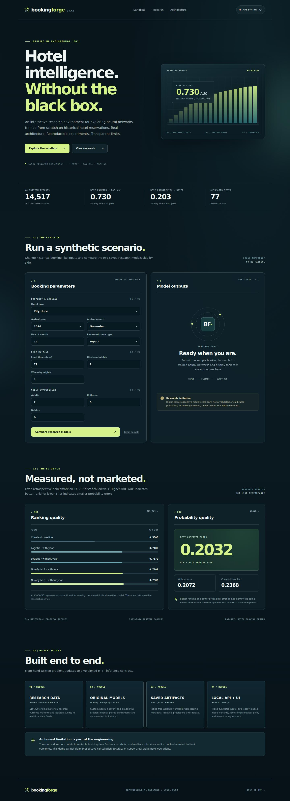

# BookingForge

**Hotel Booking Intelligence · Reproducible ML Research and Full-Stack Engineering**

[Research methods](docs/EXPERIMENT_RESULTS.md) · [Frontend demo](docs/FRONTEND_DEMO.md) · [API contract](docs/API_RESEARCH.md)

BookingForge is a complete **local research-demo architecture** combining two original, from-scratch NumPy neural networks, a tested FastAPI inference service, and an interactive Next.js dashboard. Its data comes from a public historical hotel-booking dataset. It is designed to demonstrate **software engineering, numerical ML, time-based evaluation, reproducibility, and honest scientific limitations**—not to inform actual hotel decisions.

> **Research-only warning:** The dataset does not contain verified immutable booking-creation feature snapshots. This project does **not** establish real-world cancellation-risk probabilities, prospective performance, or a production-ready revenue/overbooking decision system. Enter **synthetic data only**.

## Screenshot



Local dashboard with synthetic booking inputs. Model status is offline until the training/export step is completed.

## What is implemented

| Component | Engineering evidence |
|---|---|
| Data ingestion and audits | 119,390 historical hotel bookings; temporal split, data validity, outcome maturity and feature leakage checks |
| Original ML algorithms | Exact NumPy kNN; one-hidden-layer NumPy neural network with analytical backpropagation, Adam, reproducible training and numerical gradient checks |
| Comparisons and reliability | Logistic regression + constant-prior baselines; time-separated retrospective validation; calibration bins, hotel/month breakdowns and exploratory paired bootstrap |
| Persistent model artifacts | Train-fitted preprocessing and original MLP weight arrays; JSON + NPZ, SHA-256 checks; verified **zero** save/reload prediction discrepancy |
| FastAPI backend | Local, input-validated JSON research prediction routes; two original models loaded once at startup; no request-time fitting |
| Next.js 16 / React 19 dashboard | Synthetic booking form, side-by-side model scores, historical research results, backend health indicator and architecture walkthrough |
| Automation & local packaging | **77 Python tests**; four frontend contract tests passed in a local Node 22 test runner; GitHub Actions workflow and localhost-only Docker Compose added |

[](https://github.com/ayushvamja97/bookingforge/actions/workflows/checks.yml)

Python tests and frontend tests, TypeScript checks, and production build passed in [Actions run 41499765559](https://github.com/ayushvamja97/bookingforge/actions/runs/41499765559). Docker Compose startup is a separate local check.

## Research findings (separate retrospective arrival-cohort study)

*Fit on 58,792 arrivals from July 2015–August 2016 with labels available by September 30, 2016; retrospectively scored 14,517 October–December 2016 arrivals.*

| Model | ROC AUC ↑ | Average precision ↑ | Brier ↓ |
|---|---:|---:|---:|
| Constant training prior | 0.5000 | 0.3822 | 0.2368 |
| Logistic regression, with year | 0.7182 | 0.6154 | 0.2175 |
| Logistic regression, without year | 0.7172 | 0.6140 | 0.2064 |
| Original NumPy MLP, with year | 0.7207 | 0.6383 | **0.2032** |
| Original NumPy MLP, without year | **0.7300** | **0.6456** | 0.2072 |

The without-year MLP ranks outcomes best, while the with-year MLP achieves the lowest probability squared error. These are distinct outcomes of **the same already-inspected retrospective validation cohort**, not independent model-selection evidence. Original booking-time validity and prospective calibration remain unverified. Earlier cohort experiments revealed serious maturity-selection bias; their negative findings are preserved in the [experiment ledger](docs/EXPERIMENT_RESULTS.md).

## Architecture

```text
 Local browser (127.0.0.1:3000)
       │ synthetic booking inputs
       ▼
 Next.js / React dashboard
       │ same-origin /api/research/compare
       ▼
 Next.js server proxy ──► FastAPI (127.0.0.1:8000)
                                  │
                                  ├─ Arrival-year MLP
                                  └─ No-year MLP
                                      │
                            SHA-256 verified NPZ weights
                            + train-fitted JSON preprocessors
```

The frontend proxies from its own server, so the browser doesn't need CORS access to FastAPI. Both development servers bind to **127.0.0.1** by default. Docker Compose publishes the ports only to **localhost**; it must not be exposed publicly without a different security design.

## Run locally — Windows PowerShell

**Prerequisites:** Python 3.12, Node.js 22+, npm and Git. From a fresh clone, create the local models before starting the API. Training uses the public historical dataset and can take several minutes; it is not performed on web requests.

```powershell
git clone https://github.com/ayushvamja97/bookingforge.git
cd bookingforge
python -m venv .venv
.\.venv\Scripts\python.exe -m pip install -r requirements-api.txt
New-Item -ItemType Directory -Force data/raw | Out-Null
Invoke-WebRequest https://raw.githubusercontent.com/rfordatascience/tidytuesday/master/data/2020/2020-02-11/hotels.csv -OutFile data/raw/hotels.csv
$env:PYTHONPATH = (Join-Path (Get-Location) "src")
.\.venv\Scripts\python.exe -m bookingforge.model_artifact --csv data/raw/hotels.csv --output-dir models/arrival_v1 --report reports/arrival_artifact_verification.json --variant both --epochs 30
```

The exporter creates both JSON preprocessors and NPZ weight files under `models/arrival_v1/` and checks save/reload predictions. The source CSV and generated artifacts stay local. See the expected dataset hash below.

In **Terminal 1**, start the existing backend:

```powershell
# From the repository root
$env:PYTHONPATH = (Join-Path (Get-Location) "src")
.\.venv\Scripts\python.exe -m uvicorn bookingforge.api:app --host 127.0.0.1 --port 8000
```

In **Terminal 2**, install, test and start the new frontend:

```powershell
cd frontend
npm install
npm run test
npm run typecheck
npm run build
npm run dev
```

Open **http://127.0.0.1:3000**. The status indicator should show two models online. Click **Compare research models** to score the default fabricated reservation against both fixed NumPy models. You can edit historical synthetic attributes, compare raw scores, and copy the resulting JSON. The interface does **not** claim a risk prediction usable at original reservation creation.

To repeat the backend suite, from the repo root:

```powershell
.\.venv\Scripts\python.exe -m pip install -r requirements-api.txt
.\.venv\Scripts\python.exe -m unittest discover -s tests -v
```

If the saved models are missing, train/export them first using the [API setup guide](docs/API_RESEARCH.md). **Never commit the raw CSV, saved weights, real guest information, or private company data.**

### Optional local Docker Compose

From the root after you have the saved model artifacts, stop existing servers that occupy 3000 or 8000, then:

```powershell
docker compose up --build
```

The backend mounts `./models/arrival_v1` read-only and the frontend reaches `http://api:8000` inside the Compose network. Published ports are host-local only. Stop with Ctrl+C, then `docker compose down`. **No public hosting, auth, HTTPS, rate limiting or real-guest privacy infrastructure has been implemented.**

Once both servers are running, open another terminal in `frontend` and run `npm run smoke` to verify the **browser proxy → FastAPI → saved NumPy models** request path with a fabricated reservation. This needs local saved model files, so it isn't run in CI.

## Automated quality checks

A GitHub Actions workflow in [`.github/workflows/checks.yml`](.github/workflows/checks.yml) runs synthetic Python ML/API tests and the frontend's Node tests, TypeScript checks and production build on push and pull requests. The frontend has a separate [setup guide](frontend/README.md) and dependency manifest.

The source CSV is **not included**; the public [TidyTuesday hotel-booking dataset](https://github.com/rfordatascience/tidytuesday/blob/master/data/2020/2020-02-11/hotels.csv) goes at `data/raw/hotels.csv`. Expected SHA256:

`7c2ae42a7353905ea136e5c2287f17c92c5435826598bfbb8491c6f0c7b1fc06`

## Limitations and research integrity

- The original dataset is bounded by **arrival** rather than **creation** date, and historical predictors aren't immutable booking-time snapshots.
- The earlier outcome-maturity-selected validation made eventual 2017 arrivals appear to have 100% cancellations in selected groups; we diagnosed and reported this structural artifact rather than hiding it.
- The 2017 nominal test holdout is not pristine because legacy *aggregate* audits previously read its outcomes. Independent confirmation requires a new, genuinely sequestered cohort.
- Retrospective model metrics are not a guarantee of live performance. The fixed bootstrap intervals omit refitting and correlated observations.
- Both saved models are research alternatives; their historical scores do not authorize model selection for hotel operations.

## Documentation

- [Experiment ledger and negative results](docs/EXPERIMENT_RESULTS.md)
- [Research dataset contract](docs/DATA_CONTRACT.md)
- [Booking-time limitations](docs/BOOKING_TIME_CONTRACT.md)
- [Retrospective baseline protocol](docs/BASELINE_PROTOCOL.md)
- [Local API reference](docs/API_RESEARCH.md)
- [Full-stack demo and Docker guide](docs/FRONTEND_DEMO.md)


## License

[MIT](LICENSE) for project code. The external dataset and dependencies retain their own licenses.
